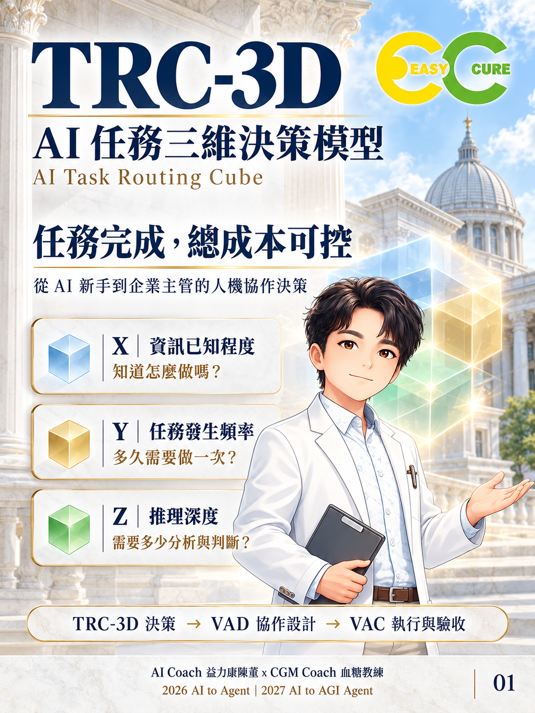

# TRC-3D｜AI 任務三維決策模型

AI Task Routing Cube：從 AI 新手到企業主管皆可使用的人機協作決策方法論。

**在品質、時間與風險要求下，讓任務完成、總成本可控。**

## 為何使用

企業需要先判斷工作特性，再選擇人機分工與 AI 能力配置。模型單價只是成本項目；建置、執行、人工覆核、返工與維護也必須納入。

## 三個維度

| 維度 | 判斷問題 | 影響 |
|---|---|---|
| X 資訊已知程度 | 知道怎麼做嗎？ | 查找、探索與不確定性處理 |
| Y 任務發生頻率 | 多久需要做一次？ | 建置、重複運作與維護投入 |
| Z 推理深度 | 需要多少分析與判斷？ | 計算工具、方案權衡與人工核決 |

## 使用流程

TRC-3D 決策 → VAD 協作設計 → VAC 執行規格 → 執行、驗收與回饋。

輸入：任務目標、可用資料、頻率、推理要求、品質／時間／風險／預算限制。
輸出：三維診斷、協作方式、理由、成本控制條件與 VAD／VAC 交接紀錄。
驗收：成果達標且總投入可追蹤；超限依預設條件調整或停止。

## 五分鐘開始

不需安裝套件或提供 API 金鑰。

1. 閱讀 [三維定義與決策規則](docs/methodology.md)。
2. 選擇一件工作，填寫 [診斷表](templates/diagnosis.md)。
3. 對照 [三組完整案例](examples/paired-cases.md)。
4. 填寫 [VAD／VAC 交接表](templates/handoff.md)，事先定義驗收與停止條件。
5. 用 [成本紀錄表](templates/cost-log.csv) 和 [驗收表](templates/acceptance.md) 記錄實測結果。

例如：每天回答配送問題，政策已提供，僅需擷取與整理。初步診斷 X 高、Y 高、Z 低，候選方案為核定資料搭配回覆範本；查無政策則轉人工。這是教學示範，尚未宣稱完成真實營運測試。

## 適用與限制

適合企業工作診斷、教學、導入前試辦與決策紀錄。不直接產生所有任務的唯一最佳路由，也不替代專業核決或風險審查。高低標籤為本版操作化建議，不是已驗證量尺。

## 內容入口

- [方法論與路由規則](docs/methodology.md)
- [成本控制與 VAD／VAC 交接](docs/handoff-and-economics.md)
- [驗證與反證方案](docs/validation-protocol.md)
- [三組對照案例、六項任務](examples/paired-cases.md)
- [一份已填寫診斷示範](examples/filled-diagnosis.md)
- [網誌文章](docs/blog.md)
- [六張圖卡](assets/cards/README.md)
- [典雅智境設計說明與素材來源](assets/PROVENANCE.md)
- [檢查紀錄](docs/verification.md)
- [貢獻方式](CONTRIBUTING.md)、[版本紀錄](CHANGELOG.md)、[發布說明](RELEASE_NOTES.md)

## 版本與下一步

0.1.0｜2026-10-17｜方法論與教學試辦版。唯一中繼資料來源為 project.json。
下一步：執行獨立任務試辦，檢查評分一致性及成本控制成效。

## 授權與作者

本 repo 採保留所有權利（All rights reserved），見 [LICENSE](LICENSE)，不是開源授權；法律權利人為 AI Coach 益力康陳董。圖卡、Logo 與人物素材不得推定可自由再授權。未查證最早公開時間，不宣稱全球首創或優於其他決策模型。

AI Coach 益力康陳董 x CGM Coach 血糖教練 | 2026 AI to Agent | 2027 AI to AGI Agent
